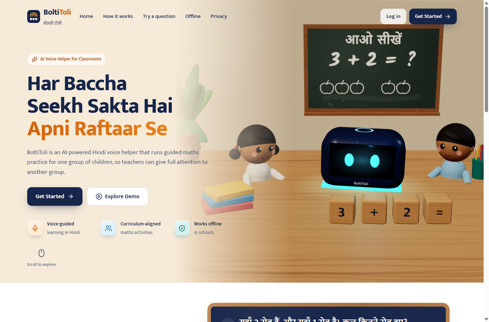
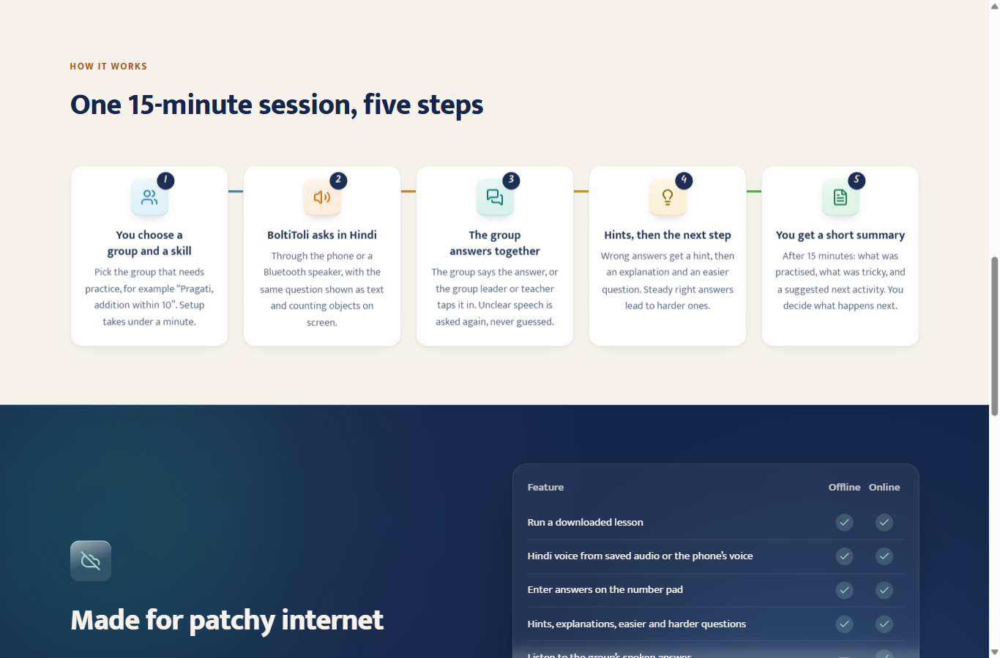
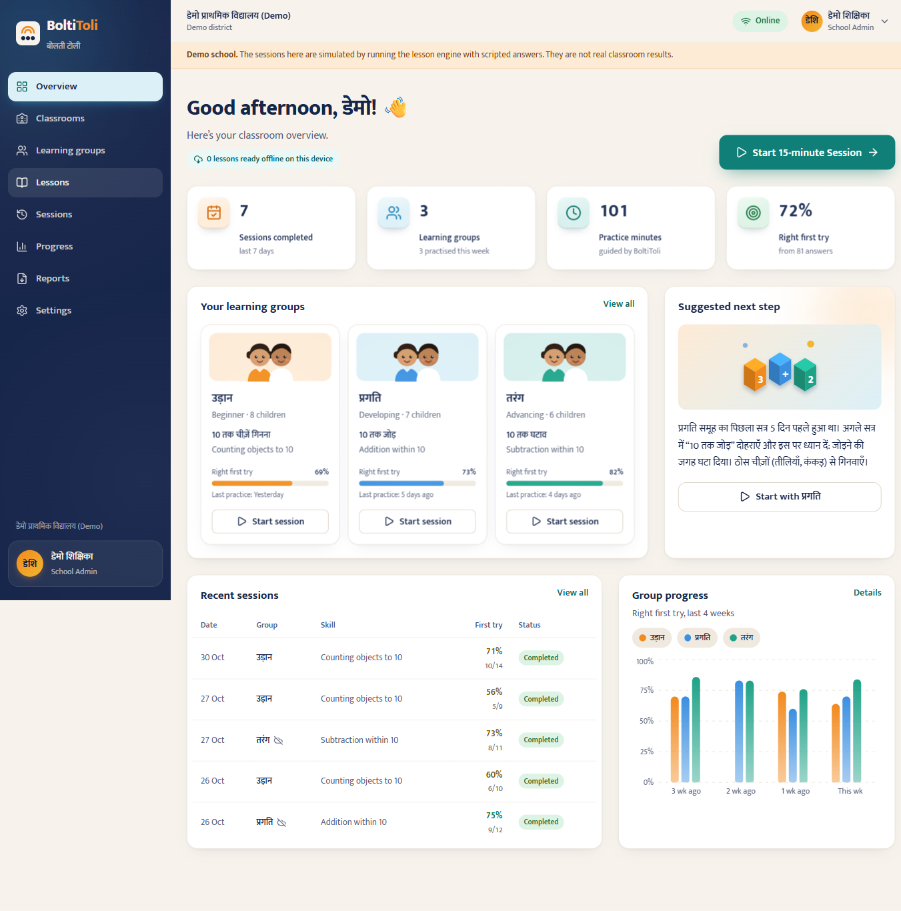
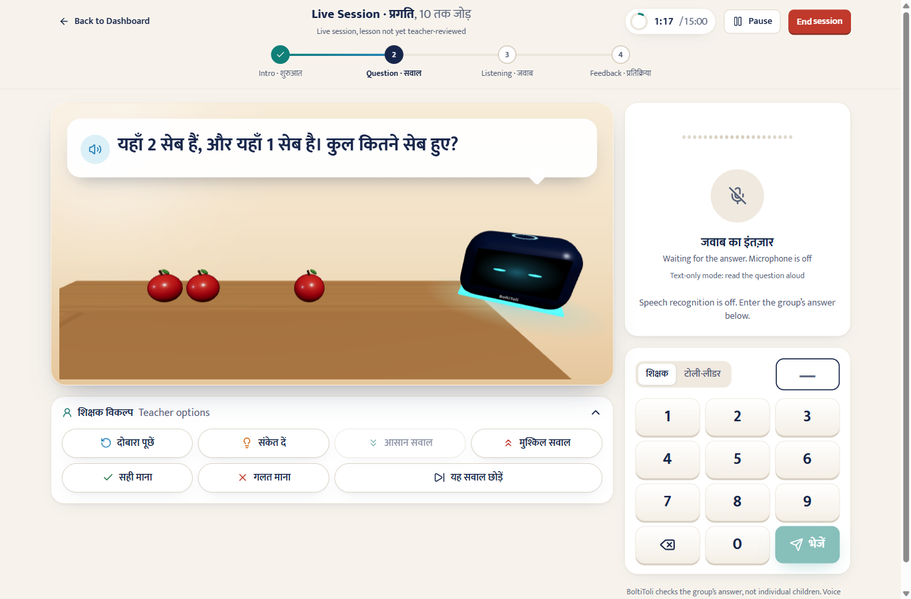
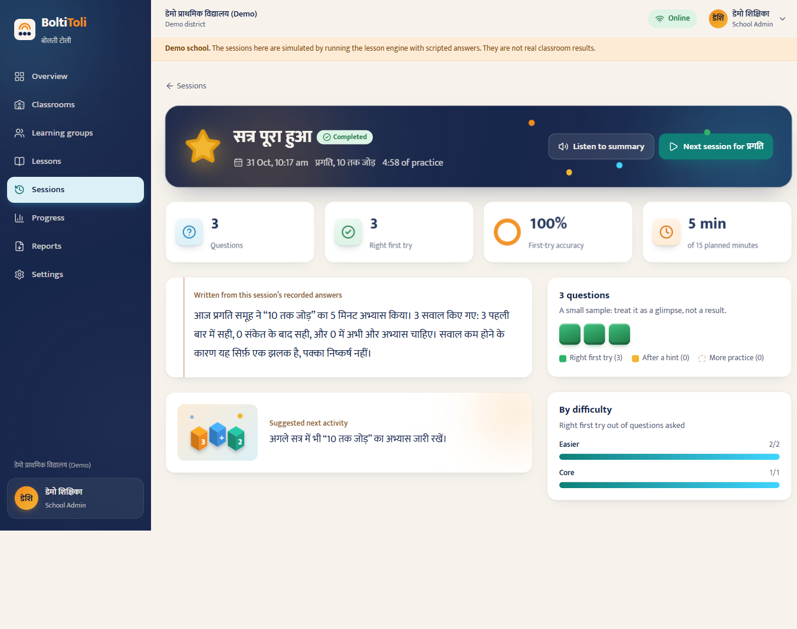
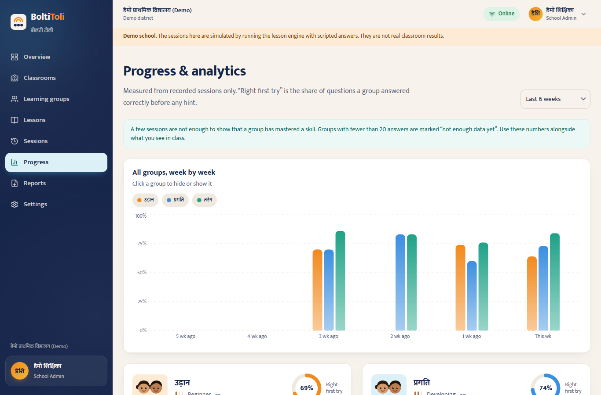
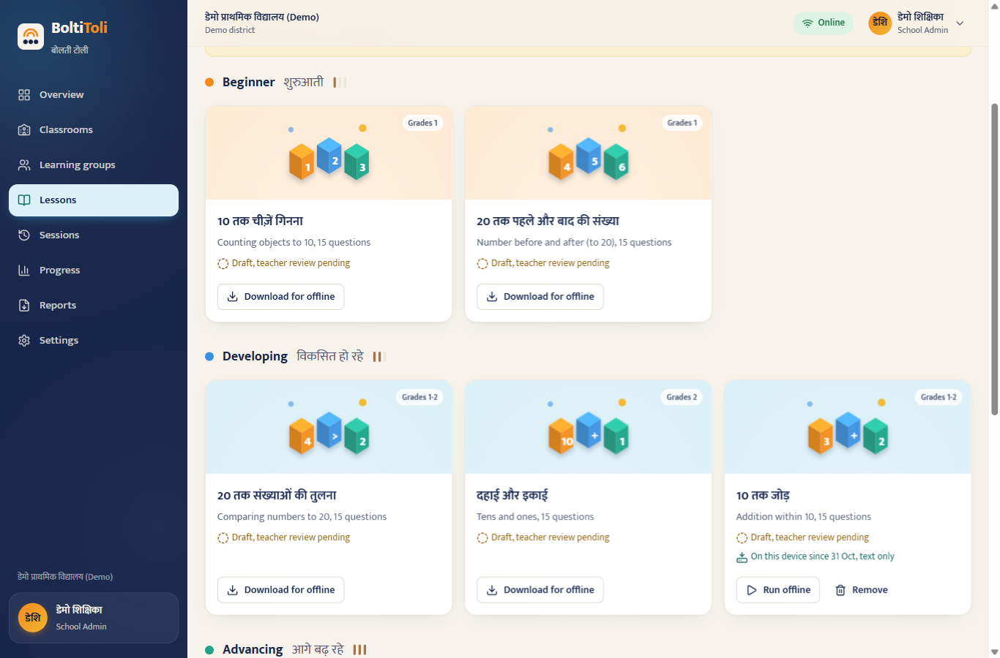
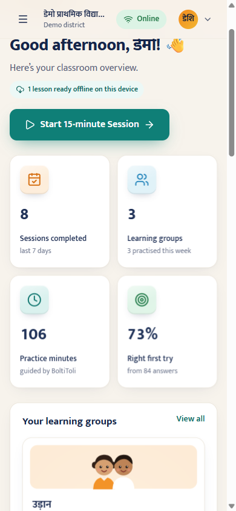

# BoltiToli · बोलती टोली

**A Hindi voice helper for multigrade classrooms.** BoltiToli runs a 15-minute guided maths practice
session with one group of children — speaking the question, listening for the group's answer, giving
hints and adjusting difficulty — so the teacher can give full attention to another group. Afterwards
the teacher gets a short, data-backed summary in Hindi.

> Technology supports the teacher; it never replaces the teacher.

Built by Team Neural Cyphers.

---

## What's in this repository

```
backend/    FastAPI + SQLAlchemy 2 + Alembic API (Python 3.11+)
frontend/   React 19 + TypeScript + Vite PWA (teacher dashboard + classroom session)
shared/     engine-fixtures.json — test vectors both lesson engines must satisfy
docs/       architecture, design direction, providers, deployment, privacy, testing, status
deploy/     nginx config for the web container
docker-compose.yml, .github/workflows/ci.yml
```

## Quick start (local, no Docker)

Requirements: Python 3.11+, Node 22.

```bash
# 1. Backend
python -m venv .venv && . .venv/bin/activate
pip install -r backend/requirements-dev.txt
cp backend/.env.example backend/.env          # optional: add ANTHROPIC_API_KEY / SARVAM_API_KEY
cd backend
alembic upgrade head                          # create the database (SQLite by default)
python -m app.cli seed                        # load the starter skill & lesson library
uvicorn app.main:app --reload --port 8000     # API docs at http://localhost:8000/api/docs
```

```bash
# 2. Frontend (new terminal)
cd frontend
npm install
npm run dev                                   # http://localhost:5173 (proxies /api to :8000)
```

Open http://localhost:5173, create an account (you become the school administrator) and follow the
setup wizard — or click **Explore the demo school** to see a clearly labelled school with simulated sessions.

## Quick start (Docker)

```bash
cp backend/.env.example backend/.env
docker compose up --build                     # http://localhost:8080
```

Compose runs PostgreSQL 16, the API (migrations + lesson seed on start) and nginx serving the PWA.
*Note: the Docker setup was written and its YAML validated, but the images could not be built in the
environment this was developed in (no Docker daemon). Please run it once before relying on it.*

## Everyday commands

| Task | Command |
|---|---|
| Backend tests (SQLite) | `cd backend && pytest -q` |
| Backend tests (PostgreSQL) | `TEST_DATABASE_URL=postgresql+psycopg://user@host/db pytest -q` |
| Backend lint | `cd backend && ruff check .` |
| New migration | `cd backend && alembic revision --autogenerate -m "describe change"` |
| Apply migrations | `cd backend && alembic upgrade head` |
| Frontend unit/component tests | `cd frontend && npm test` |
| Frontend lint / types | `npm run lint && npm run typecheck` |
| Production build | `cd frontend && npm run build` |
| End-to-end tests | `cd frontend && npx playwright install chromium && npx playwright test` |
| Regenerate lesson content | `cd backend && python -m app.lesson_engine.content.build_content` |
| Regenerate engine fixtures | `cd backend && PYTHONPATH=. python scripts/build_engine_fixtures.py` |
| Demo school | `python -m app.cli seed-demo [--reset]` |
| Grant an official read access | `python -m app.cli create-official --email … --name … --school <id>` |
| Apply data retention | `python -m app.cli apply-retention` |

## AI and voice providers

All provider keys live only on the backend (`backend/.env`). Without keys the product still works:

| Capability | With keys | Without keys |
|---|---|---|
| Correctness, hints, next question | Deterministic lesson engine | Same — AI never decides correctness |
| Teacher summary | Claude, validated against session numbers | Rule-based Hindi summary |
| Hindi speech | Sarvam Bulbul (cached clips) | Phone's built-in Hindi voice, else text only |
| Listening to answers | Sarvam Saaras, teacher confirms | Number pad (teacher or group leader) |
| Drafting extra questions | Claude → draft version, teacher reviews | Not available |

See [docs/PROVIDERS.md](docs/PROVIDERS.md) to configure Claude and Sarvam.

## Documentation

- [docs/STATUS.md](docs/STATUS.md) — **what works, what was tested, what still needs real-world validation**
- [docs/ARCHITECTURE.md](docs/ARCHITECTURE.md) — system design, data model, lesson engine, offline sync, API
- [docs/DESIGN.md](docs/DESIGN.md) — art direction, tokens, typography, 3D and motion principles
- [docs/PROVIDERS.md](docs/PROVIDERS.md) — Claude and Sarvam setup
- [docs/PITCH.md](docs/PITCH.md) — one-page summary for the AI for Foundational Learning Hackathon
- [docs/ROADMAP.md](docs/ROADMAP.md) — pilot, broadening, and integration with existing systems
- [docs/USER-TESTING.md](docs/USER-TESTING.md) — teacher test script and refinement log
- [docs/DEPLOYMENT.md](docs/DEPLOYMENT.md) — production hosting, PostgreSQL, backups
- [docs/PRIVACY.md](docs/PRIVACY.md) — data minimisation, consent, retention, responsible AI
- [docs/TESTING.md](docs/TESTING.md) — test strategy and how to run each suite
- [docs/TROUBLESHOOTING.md](docs/TROUBLESHOOTING.md) — common setup problems

API reference: run the backend and open `/api/docs` (Swagger) or `/api/redoc`.

## Screenshots

| | |
|---|---|
|  |  |
|  |  |
|  |  |
|  |  |
