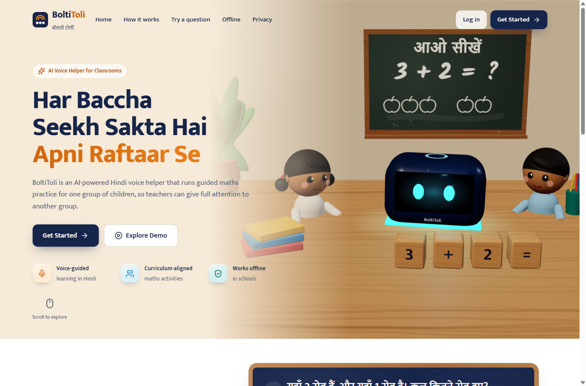
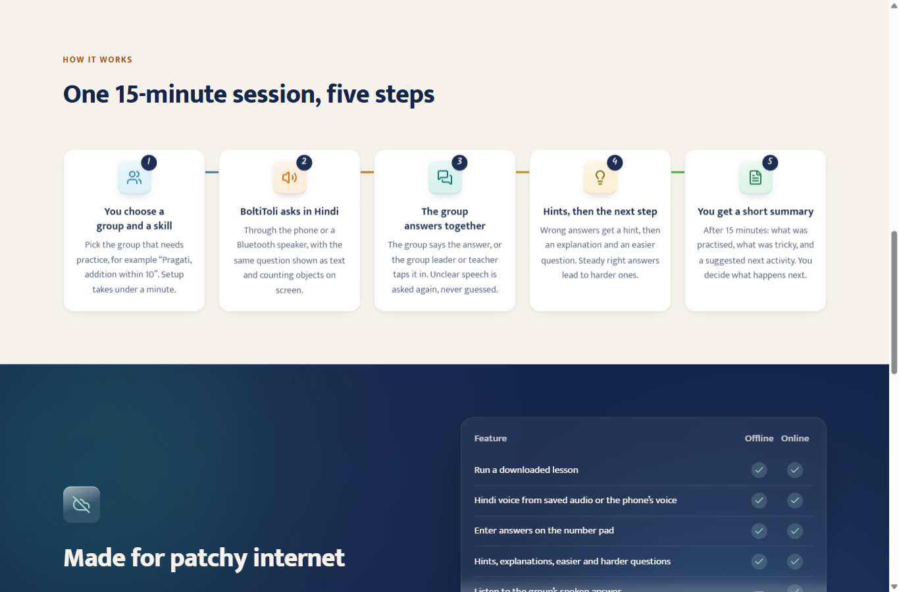
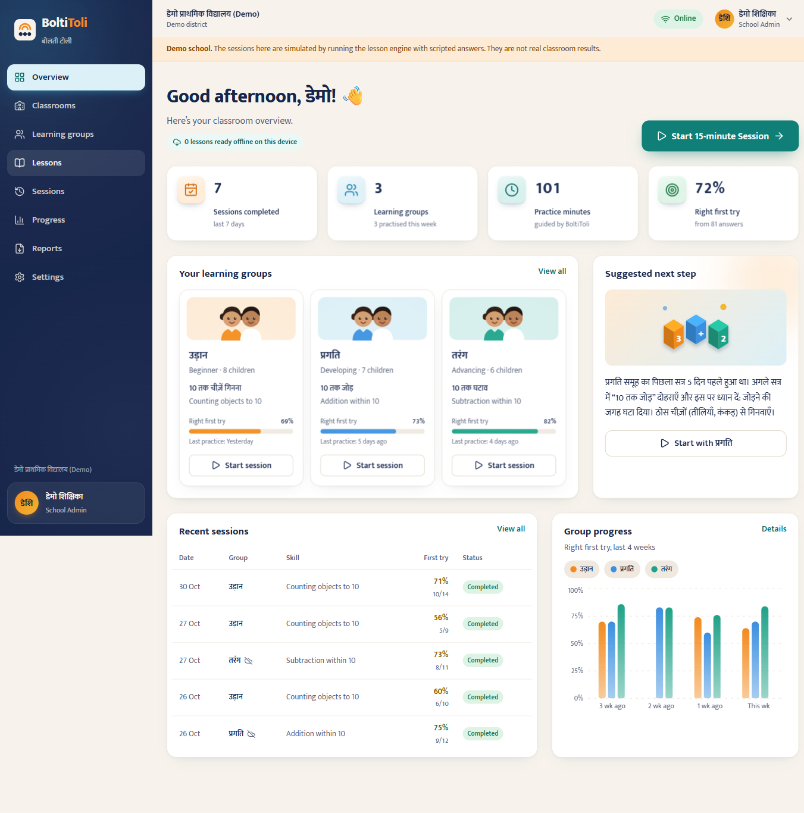
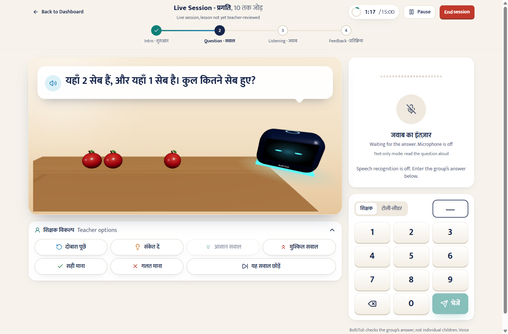
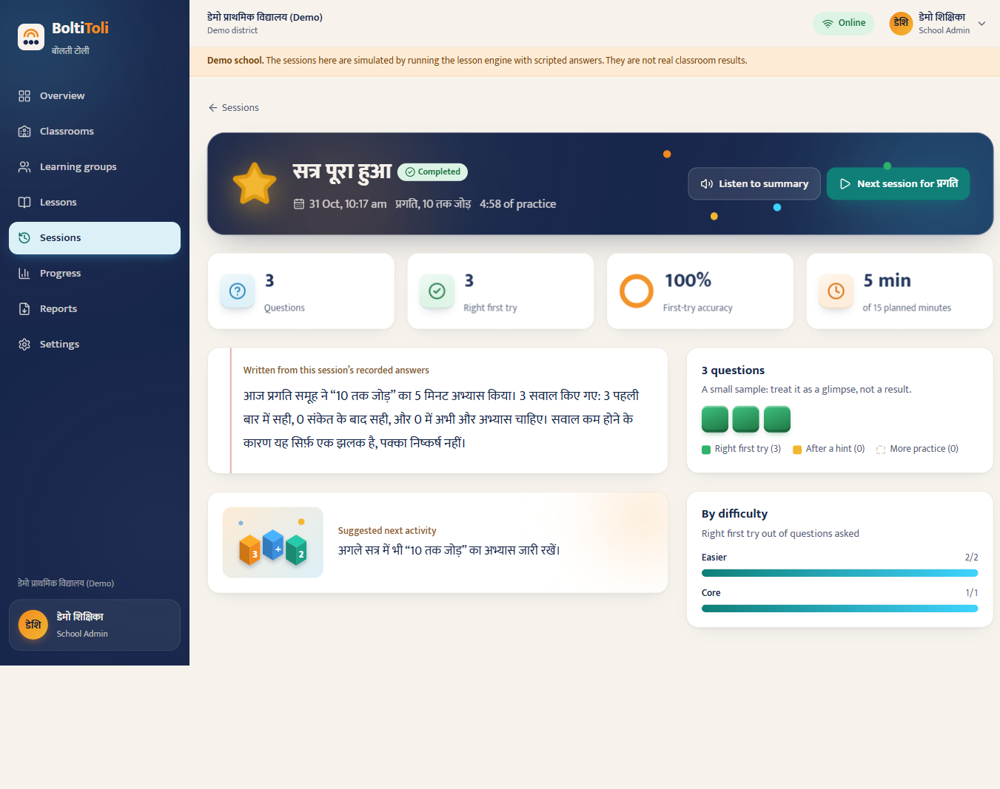
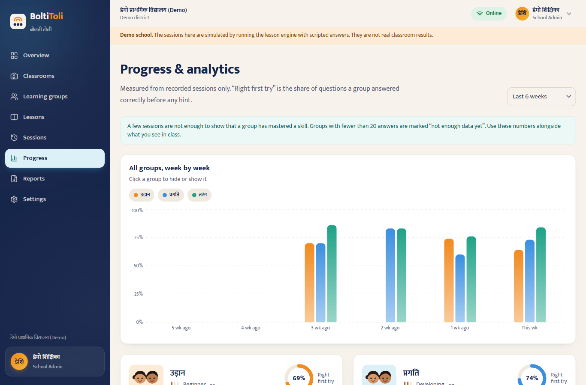
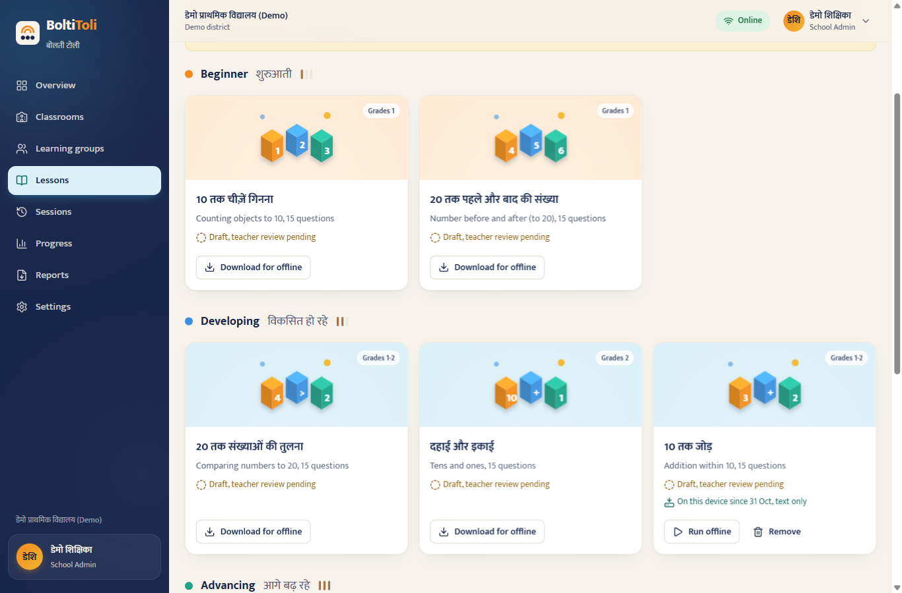
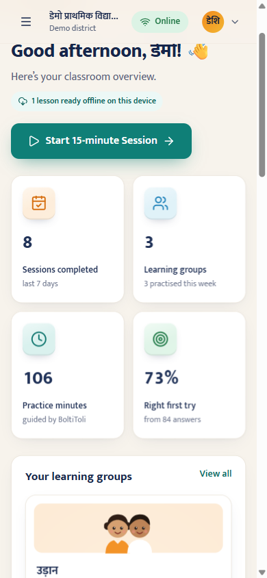
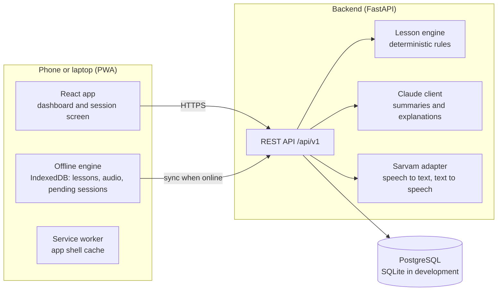

<div align="center">

# BoltiToli · बोलती टोली

**A Hindi voice helper for multigrade classrooms**

BoltiToli runs a 15-minute guided maths practice with one group of children, speaking each question,
listening for the group's answer, giving hints and adjusting difficulty, so the teacher can give full
attention to another group.

*Technology supports the teacher. It never replaces the teacher.*

Built by **Team Neural Cyphers** for the **AI for Foundational Learning Hackathon**

[Overview](#overview) · [Features](#features) · [Screenshots](#screenshots) · [Architecture](#architecture) ·
[Quick start](#quick-start) · [Testing](#testing) · [Deployment](#deployment) · [Documentation](#documentation)

</div>

---

## Overview

### The problem

In a multigrade classroom one teacher works with children at several learning levels at the same time.
While the teacher helps one group, the other groups wait or work without guidance. Personalised practice for
every group is not possible with one adult in the room.

### The solution

One phone or laptop, optionally with a Bluetooth speaker, serves a **whole group** of children:

1. The teacher picks a group and a skill. Setup takes under a minute.
2. BoltiToli **asks in Hindi**, with the same question on screen and countable 3D or 2D objects.
3. The group **answers together by voice**, or the group leader or teacher taps the number pad.
4. A wrong answer gets a **hint**, then an **explanation and an easier question**. Steady right answers lead to harder ones.
5. The teacher receives a **short Hindi summary**: what was practised, what was difficult, and a suggested next activity.

The teacher can repeat, skip, override or end the session at any time.

### What makes it different

| Typical learning app | BoltiToli |
|---|---|
| One child per device | One device per **group**, designed for multigrade rooms |
| AI decides what is correct | **Fixed lesson rules** decide correctness; AI only explains and summarises |
| Needs constant internet | Downloaded lessons run **offline** and sync later without duplicates |
| Collects child profiles | **No children's names or voice recordings** are stored |

---

## Features

**For the classroom**
- Spoken Hindi questions (Sarvam Bulbul, or the phone's own Hindi voice), with on-screen text and objects
- Voice answers through Sarvam Saaras; a person confirms what was heard before it is graded
- Hints, explanations and adaptive difficulty from a deterministic lesson engine
- Detection of common mistake patterns, for example counting one too many, or adding instead of subtracting
- Teacher controls: repeat, hint, easier or harder question, mark right or wrong, skip, pause, end

**For the teacher**
- Dashboard with sessions, practice minutes, first-try accuracy and per-group progress charts
- Hindi session summaries written by Claude, checked against the session's own numbers, with a rule-based fallback
- Lesson library of 9 lessons and 135 questions for Grades 1 to 3, informed by NIPUN Bharat numeracy goals
- AI-assisted drafting of extra questions, saved as a draft that a teacher must review
- CSV reports, consent and data-retention controls, and an audit log for administrators

**Built for real conditions**
- Progressive web app: downloaded lessons and the app shell work without internet
- Automatic 2D illustrations on low-end phones, slow networks or devices without WebGL
- Teacher interface in **Hindi by default** with an English switch (`हिं | EN`)
- Accessibility checked with axe in the end-to-end tests; reduced-motion settings are respected
- Roles for teachers, school administrators and cluster or block officials (aggregates only)

---

## Screenshots

| | |
|---|---|
|  |  |
|  |  |
|  |  |
|  |  |

---

## Architecture



- The **lesson engine** decides correctness and the next question. It exists in Python and TypeScript, and
  both implementations must pass the same shared test vectors (`shared/engine-fixtures.json`).
- **Claude** and **Sarvam** are optional. Without keys every core feature still works.
- Full details: [ARCHITECTURE.md](ARCHITECTURE.md).

### Tech stack

| Layer | Technology |
|---|---|
| Frontend | React 19, TypeScript 5.9, Vite 8, Tailwind CSS 4, TanStack Query 5, React Router 7 |
| 3D and motion | three.js, React Three Fiber, drei, Framer Motion |
| Charts | Recharts 3 |
| Offline | vite-plugin-pwa (Workbox), IndexedDB |
| Backend | Python 3.11+, FastAPI, SQLAlchemy 2, Alembic, Pydantic 2 |
| Database | PostgreSQL 16 in production, SQLite for development |
| AI | Claude Sonnet 5.5 (summaries, drafting), Claude Haiku 5.5 (live explanations) |
| Speech | Sarvam Saaras v4 (speech to text), Sarvam Bulbul v3 (text to speech) |
| Testing | pytest, Vitest, Testing Library, Playwright, axe |
| Delivery | Docker, Docker Compose, nginx, GitHub Actions CI |

---

## Quick start

### Requirements

- Python 3.11 or newer
- Node.js 22
- Optional: Docker Desktop (for the full PostgreSQL stack)
- Optional: a Claude API key and a Sarvam API key

### 1. Backend

**Windows (PowerShell)**
```powershell
cd backend
py -3.12 -m venv .venv
.venv\Scripts\activate
pip install -r requirements-dev.txt
copy .env.example .env
alembic upgrade head
python -m app.cli seed
uvicorn app.main:app --reload --port 8000
```

**macOS or Linux**
```bash
cd backend
python3 -m venv .venv && source .venv/bin/activate
pip install -r requirements-dev.txt
cp .env.example .env
alembic upgrade head
python -m app.cli seed
uvicorn app.main:app --reload --port 8000
```

Check that it is running: http://localhost:8000/api/v1/health returns `{"status":"ok"}`.
Interactive API documentation: http://localhost:8000/api/docs

### 2. Frontend

In a second terminal:
```bash
cd frontend
npm install
npm run dev
```

Open http://localhost:5173. Create an account (you become the school administrator) and follow the setup
wizard, or choose **Explore the demo school** to see a clearly labelled school with simulated sessions.

### Full stack with Docker (optional)

```bash
cp backend/.env.example backend/.env
docker compose up --build
```

Open http://localhost:8080. Compose runs PostgreSQL 16, the API (database migrations and lesson seed run on
start) and nginx serving the production build. The Docker images have not yet been built and verified by the
team; run it once before relying on it.

---

## Configuration

All settings live in `backend/.env`, created from [`backend/.env.example`](../backend/.env.example).
Never commit a real `.env` file; it is excluded by `.gitignore`.

| Variable | Purpose | Default |
|---|---|---|
| `ENVIRONMENT` | `development` or `production` (production refuses unsafe settings) | `development` |
| `DATABASE_URL` | Database connection | SQLite file |
| `JWT_SECRET` | Signs login tokens; use 48+ random characters | development value |
| `CORS_ORIGINS` | Allowed frontend origins, comma separated | localhost |
| `ANTHROPIC_API_KEY` | Enables Claude summaries, explanations and drafting | empty |
| `SARVAM_API_KEY` | Enables Hindi speech recognition and speech | empty |
| `DEMO_MODE_ENABLED` | Shows the public demo school | `true` |
| `TRUSTED_PROXY_HOPS` | Proxies in front of the API, for correct rate limiting | `0` |

### What the provider keys add

| Capability | With keys | Without keys |
|---|---|---|
| Correctness, hints, next question | Deterministic lesson engine | Same; AI never decides correctness |
| Teacher summary | Claude, checked against session numbers | Rule-based Hindi summary |
| Hindi speech | Sarvam Bulbul, clips cached for offline use | Phone's built-in Hindi voice, else text only |
| Listening to answers | Sarvam Saaras, a person confirms | Number pad (teacher or group leader) |
| Drafting extra questions | Claude, saved as a draft for teacher review | Not available |

Setup guide: [PROVIDERS.md](PROVIDERS.md).

---

## Testing

| Suite | Command | Latest result |
|---|---|---|
| Backend (pytest) | `cd backend && pytest -q` | 100 passed |
| Backend lint (ruff) | `cd backend && ruff check .` | clean |
| Frontend unit and component (Vitest) | `cd frontend && npm test` | 64 passed |
| Frontend lint and types | `npm run lint && npm run typecheck` | clean |
| End-to-end and accessibility (Playwright, axe) | `cd frontend && npx playwright test` | 6 passed |

The lesson engine is tested from shared fixtures in both languages. CI runs the backend on SQLite and
PostgreSQL, checks migrations, and runs the frontend and end-to-end suites on every pull request.
Details, Windows notes and dated results: [TESTING.md](TESTING.md).

---

## Deployment

Recommended free setup: **Vercel** (frontend), **Render** (backend container), **Neon** (PostgreSQL).
With `ENVIRONMENT=production` the API refuses to start with a weak secret, an SQLite database or insecure
cookies. Full guide, production settings and a pre-pilot checklist: [DEPLOYMENT.md](DEPLOYMENT.md).

---

## Security and privacy

- Passwords are hashed with bcrypt; refresh tokens rotate on every use and reuse revokes all sessions
- Rate limits on login, registration, speech, answers, session end and AI drafting
- The public demo school cannot change shared data or delete records, and it is rebuilt every 24 hours
- No children's names, photos or voice recordings are stored; Claude receives only session counts
- Provider keys stay on the server and are never sent to the browser

Details: [PRIVACY.md](PRIVACY.md). This describes how the software is built; it is not legal advice, and the
DPDP Act review has not yet been done.

---

## Project structure

```
backend/      FastAPI API, lesson engine, AI and speech adapters, Alembic migrations, tests
frontend/     React PWA: teacher dashboard, live session, offline engine, 3D scenes, e2e tests
shared/       engine-fixtures.json, test vectors both lesson engines must pass
docs/         this README and all project documentation
deploy/       nginx configuration for the web container
.github/      continuous integration workflow
```

---

## Documentation

| Document | What it covers |
|---|---|
| [PITCH.md](PITCH.md) | One-page summary mapped to the hackathon criteria |
| [STATUS.md](STATUS.md) | What works, what was tested, what still needs real-world validation |
| [PROGRESS.md](PROGRESS.md) | Done, in progress and next |
| [ROADMAP.md](ROADMAP.md) | Pilot, broadening and integration with existing systems |
| [ARCHITECTURE.md](ARCHITECTURE.md) | System design, data model, lesson engine, offline sync, API |
| [decisions.md](decisions.md) | Key technical decisions, their reasons and alternatives |
| [DESIGN.md](DESIGN.md) | Visual design, tokens, language switch, 3D and motion |
| [PROVIDERS.md](PROVIDERS.md) | Claude and Sarvam setup and live test results |
| [DEPLOYMENT.md](DEPLOYMENT.md) | Hosting, production settings, rate limits, backups |
| [PRIVACY.md](PRIVACY.md) | Data minimisation, consent, retention, responsible AI |
| [TESTING.md](TESTING.md) | Test strategy, commands and dated results |
| [USER-TESTING.md](USER-TESTING.md) | Teacher test script and refinement log |
| [TROUBLESHOOTING.md](TROUBLESHOOTING.md) | Common setup problems |
| [glossary.md](glossary.md) | Technical terms in simple words |
| [learning-log.md](learning-log.md) | What was built and the concepts behind it |
| [CONTRIBUTING.md](CONTRIBUTING.md) | How to set up, work and submit changes |
| [CODE_OF_CONDUCT.md](CODE_OF_CONDUCT.md) | Community standards |

---

## Project status

BoltiToli is a working product that has **not yet been validated in a real classroom**. The starter lessons
are drafts until a teacher reviews them, and the Hindi interface wording awaits review by a primary teacher.
Speech recognition has been checked with synthesised audio, but not yet with children's voices or classroom
noise. See [STATUS.md](STATUS.md) for the complete, candid list.

---

## Acknowledgements

- Skill progression informed by the **NIPUN Bharat** foundational numeracy goals
- **Claude** by Anthropic for Hindi summaries, explanations and question drafting
- **Sarvam AI** for Hindi speech recognition and speech
- Fonts: **Mukta** (Ek Type) and **Kalam**, self-hosted for offline use

<div align="center">

Built with care for teachers by **Team Neural Cyphers**

</div>
